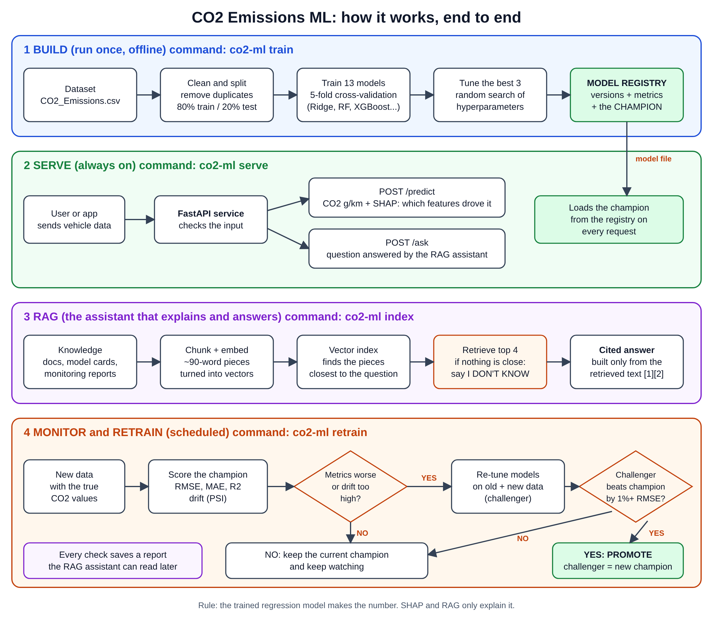

# CO2 Emissions: MLOps + RAG Project

Predict a vehicle's CO2 emissions (g/km) from its specs, and run the model the way a company would: versioned, monitored, automatically retrained, explainable, and served over an API with a question-answering assistant.

It turns a Colab case study (a single LinearRegression) into a deployable project.



## The idea in plain English

1. **Build:** try 13 different models on the data, keep the best one (the *champion*), and save it with its scores.
2. **Serve:** a web API loads the champion and returns predictions, plus a SHAP explanation of *why* the model gave that number.
3. **Assistant (RAG):** you can ask questions in plain language ("why did we retrain?", "what does fuel type Z mean?"). It looks up the answer in the docs, model cards and monitoring reports, and cites its sources. If it can't find an answer it says "I don't know".
4. **Monitor and retrain:** when new real data arrives, check whether the model is still accurate. If not, retrain, and replace the champion only if the new model is clearly better.

> **Rule:** the trained regression model makes the number. SHAP and the RAG assistant only explain it.

## Quick start

```bash
git clone https://github.com/expe-rience/co2-emissions-ml.git && cd co2-emissions-ml
python -m venv .venv && source .venv/bin/activate        # Windows: .venv\Scripts\activate
pip install -e . shap fastapi uvicorn anthropic           # optional: xgboost lightgbm

# dataset (not stored in the repo)
curl -L -o data/CO2_Emissions.csv "https://d2beiqkhq929f0.cloudfront.net/public_assets/assets/000/158/208/original/CO2_Emissions.csv?1760012266"

co2-ml train      # 1. compare models, save the champion
co2-ml index      # 2. build the assistant's knowledge index
co2-ml serve      # 3. API at http://localhost:8000/docs
```

No dataset yet? `cp data/synthetic_train.csv data/CO2_Emissions.csv` gives you **synthetic** data to try the commands. Its metrics mean nothing.

Optional: set `ANTHROPIC_API_KEY` to let Claude write the assistant's answers. Without it, a built-in offline writer is used.

## Commands

| Command | What it does |
|---|---|
| `co2-ml train` | Compares 13 regressors with 5-fold CV and a test split, tunes the top 3, saves the champion for two scenarios (`spec_only`, `spec_plus_consumption`) |
| `co2-ml predict --input cars.csv --output out.csv` | Batch predictions with the champion |
| `co2-ml monitor --new-data fresh.csv --reference-data data/CO2_Emissions.csv` | Scores the champion on new labelled data and checks drift. Does not retrain |
| `co2-ml retrain --new-data fresh.csv --reference-data ...` | Same check, then retrains if degraded and promotes only if better |
| `co2-ml index` | Rebuilds the assistant's knowledge index (run after every retrain) |
| `co2-ml ask "why did we retrain?"` | Ask the assistant from the terminal |
| `co2-ml serve` | Starts the API |
| `co2-ml history` | Lists model versions |

Add `--scenario spec_only` to use the model without fuel consumption.

**API endpoints:** `POST /predict?explain=true`, `POST /ask`, `POST /reindex`, `GET /health`. Interactive docs at `/docs`.

## Metrics to monitor

A model that looks fine can quietly get worse. Watch these four groups.

### 1. Model accuracy (needs true CO2 values) - implemented

| Metric | Meaning | Alert when (default, editable in `configs/config.yaml`) |
|---|---|---|
| **RMSE** (g/km) | Typical error, punishes big misses | Rises more than **10%** over the champion's baseline |
| **MAE** (g/km) | Average absolute error | Rises more than **10%** over baseline |
| **R²** | Share of variation explained (1.0 is perfect) | Falls more than **0.02** below baseline |

Baselines are the test-set scores saved with the champion. Your notebook's reference point was RMSE 3.30, R² 0.990 with fuel consumption, and RMSE 22.5, R² 0.86 without it.

### 2. Data drift (works without true values) - implemented

| Metric | Meaning | Reading it |
|---|---|---|
| **PSI** per feature | How far the new data's distribution moved from training data | under 0.1 stable, 0.1 to 0.25 watch, **over 0.25 alert** |

Drift is an early warning. Inputs can change before accuracy visibly drops.

### 3. Retrain health - implemented

| Metric | Meaning |
|---|---|
| **RMSE improvement of the challenger** | Promote only if the new model beats the champion by at least **1%** on held-out data |
| **Version history** | `co2-ml history` shows when and why each version was created |

### 4. Recommended additions for production (not built yet)

| Area | Metric | Why |
|---|---|---|
| Data quality | Missing values, out-of-range values, unseen categories | Bad inputs cause bad predictions before the model is at fault |
| Predictions | Distribution of predicted CO2, error by vehicle class and fuel type | Finds segments where the model is weak |
| Service | Latency, error rate, number of rejected (422) requests | Normal API health |
| Assistant | Share of "I don't know" answers, top retrieval score, answers with a citation | A rising "I don't know" rate means the knowledge base is stale or incomplete |
| Pipeline | Delay before true CO2 values arrive, age of the index | Accuracy checks and answers are only as fresh as this |

## Project structure

```
configs/config.yaml        all settings: models, thresholds, paths, RAG options
knowledge/                 documents the assistant can read (add your own .md files)
src/co2_ml/
  data.py pipeline.py      loading, cleaning, encoding + model as one object
  models.py train.py       the 13-model zoo, cross-validation, tuning
  registry.py              versions, metrics, champion pointer
  monitor.py               accuracy and drift checks, retrain, promote
  explain.py               SHAP explanations
  rag/                     chunk, embed, index, retrieve, generate
  service.py api.py        business logic and FastAPI service
  cli.py                   the co2-ml command
tests/                     end-to-end tests (synthetic data)
docs/flow.png flow.svg     the diagram above
LEARN.md                   step-by-step explanation of every part
Dockerfile
LICENSE                    MIT license
```

## Deploy

```bash
docker build -t co2-ml .
docker run -p 8000:8000 -v $PWD/models:/app/models co2-ml
```

The image holds code only. The `models/` folder is mounted because it changes after every retrain. Schedule monitoring weekly (cron, Airflow or GitHub Actions):

```
0 2 * * 1  cd /path/to/project && co2-ml retrain --new-data /data/last_week.csv --reference-data data/CO2_Emissions.csv && co2-ml index
```

## Notes and limitations

- Fuel consumption is a near-direct predictor of CO2 (R² 0.86 to 0.99 in the original notebook). Use the `spec_only` model when fuel consumption is unknown at prediction time.
- The default assistant search matches words, not meaning. For meaning-based search set `rag.embedder: sentence-transformers`.
- The file-based registry suits a single machine. For a team, swap `registry.py` for MLflow or cloud storage.
- Tested on synthetic data only so far. Add your own results table after training on the real dataset.
- Run tests with `pip install pytest && pytest`.

## License

Released under the [MIT License](LICENSE). Free to use, modify and share, with no warranty.
